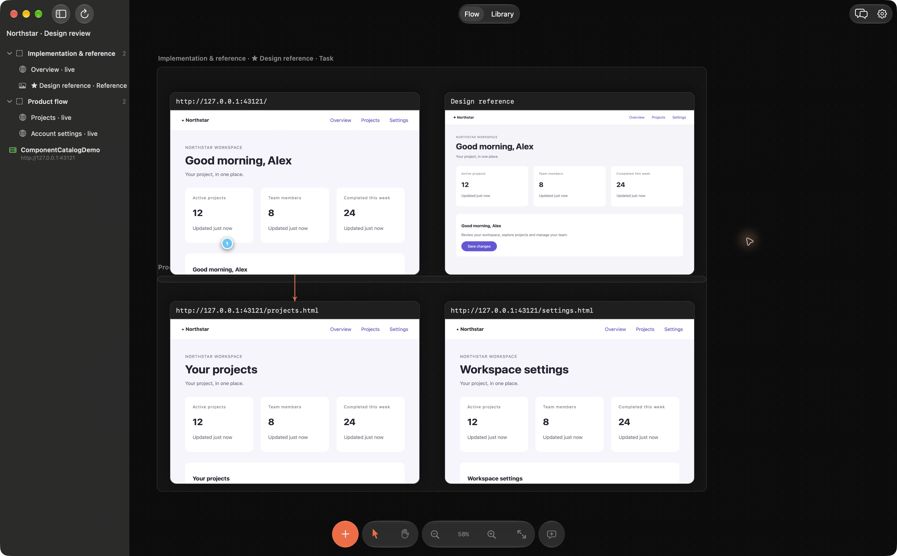

# Web Frames

A native macOS workspace for reviewing web and mobile interfaces with AI coding
agents. Keep live pages, component previews, simulator captures and PDF references
on one canvas, then pin precise feedback. Built-in web source fixes go through
review and Apply; external coding agents use their own source tools and review.

Download the signed build at [webframes.pro](https://www.webframes.pro).
Current release: **1.1.11 (16)**, Developer ID signed and Apple notarized,
including PDF page import and the complete native iOS and Android simulator workflow.
Already installed? Choose **Web Frames → Check for Updates…** in the Mac menu bar.
See the [changelog](CHANGELOG.md) for changes and MCP compatibility notes, or browse
the [guides and use cases](https://www.webframes.pro/guides).



*Captured in Web Frames 1.1.9 using the Northstar demo.*

Use the filter button in the **Comments** header to hide resolved comments and their canvas pins and area outlines. Resolved comments are muted when shown; reopening one restores its normal appearance.

## What you can do

- Inspect live web pages, localhost routes and component previews on one canvas.
- Import selected PDF pages as image frames, annotate them and compare references.
- Pin comments to elements or screenshot regions. For supported web source,
  review the built-in Fix proposal before Apply. Undo restores the source only
  while it has not been edited again.
- Collect variants in a section, choose the reference yourself and give the
  section a task for your coding agent.
- Connect a local MCP client with the setup wizard. Comment status and screenshot
  updates and native simulator captures require separate permissions, each off by default.
- Capture iOS Simulator and Android Emulator screens directly. Choose an app,
  save tap/wait/type/swipe actions and refresh the same image frame with Undo.
  Uses local Xcode or Android SDK/JDK; no tapflow account or external service. Agents can run the
  saved recipe through `capture_simulator_frame` with a separate opt-in. Refresh
  selected screens or all saved recipes in mixed iOS/Android batches, with
  per-screen results and one Undo; agents use `capture_simulator_frames`.
- Store legacy flow YAML and deeplinks for optional external runners too.
- Align frames with magnetic guides and import screenshot batches as a grid.

Component previews depend on the project's providers and sample data. Server
authentication and database access may need a mock or the project's live page.

Native simulator capture is included since 1.1.8. In Add Frames → Image / PDF, choose **Capture
from Simulator…**, or select an image and use **Simulator capture settings**.
Use **Refresh from simulator** to repeat its recipe. Choose iOS Simulator or
Android Emulator in capture settings. Xcode/iOS runtime or Android SDK/JDK are
required; Web Frames can start an existing simulator or emulator and control an
installed app. It does not create backend accounts or execute arbitrary YAML. **Record Actions…** captures clicks, vertical swipes and text entry inside
Web Frames, so screen scenarios can be assembled without typing selectors.
**Test State…** saves an account label, test data, theme, launch arguments and
preparation actions with the frame. **Start live preview** shows only the selected
frame using its saved recipe, without saving video or replacing its screenshot.
Enable **Build and install before capture** to rebuild an Xcode scheme or Gradle
module/variant and update-install the app before recording or refreshing screens.
Local build scripts require separate project permission; existing app data is kept.
See the [Simulator Capture guide](docs/simulator-capture.md) for setup and agent permissions.

## PDF page import

Choose **Add Frames → Image / PDF** and select a PDF, or drop/copy-paste a PDF
file onto the canvas. Leave the page range empty for all pages, or enter a range
such as `1-3, 7`. Up to 50 PDF pages can be imported together from files up to
100 MB each, with up to 64 MB of rendered image data per batch and a maximum
long edge of 2048 pixels. Each page becomes a static image frame with the filename and page
number, ready for comments, Compare and your agent. The images are stored in
the board; the original PDF is not needed after import and does not update the
frames automatically. The whole batch supports Undo/Redo. Locked PDFs need an
unlocked copy saved from Preview first.

Available in Web Frames 1.1.9.

## Compare and built-in Fix

Compare needs two loaded frames with exactly the same logical width and height,
a connected coding agent and an approved local web source folder. In 1.1.9 it
creates findings and proposes changes to one existing CSS file for review.

Fix from comments supports existing HTML, CSS, JavaScript, JSX, TypeScript, TSX
and JSON files. Review the proposed patch before Apply; source hashes prevent
Apply or Undo from overwriting newer edits. Build/configuration edits require
an additional confirmation.

Swift or Kotlin changes use your external coding agent's source tools and review
workflow. Web Frames can supply the visual evidence, then build/install and
refresh saved captures. For image-only research, use an MCP-connected agent to
inspect the images and report its findings.

## Requirements

- Apple Silicon Mac, macOS 15 or later
- Optional: a signed-in [Codex](https://github.com/openai/codex) or
  [Claude Code](https://claude.com/claude-code) CLI for Compare and Fix
- For native capture: local Xcode/iOS runtime or Android SDK/JDK and an emulator
- Component previews may need the project's own dependencies/providers; projects
  with custom PostCSS configuration use an existing Node 22.12+ installation

The signed download bundles Node and the local helpers. Installing Web Frames
does not require Python, npm or Xcode; Xcode is needed for the optional iOS workflow.
Building from source additionally needs Xcode 27, Python 3.12+ and network access.
`Tools/prepare_runtime.py` downloads the pinned Node/npm runtime and locked helper
packages. The test commands below use Node/npm in your development shell.

## Build and run

```sh
python3 Tools/prepare_runtime.py
open webframes.xcodeproj
```

Choose your own team under Signing & Capabilities (the project is set up for
the maintainer's Developer ID), then run the `webframes` scheme. Builds from
source do not receive Sparkle updates signed for the official release.

## Tests

```sh
npm ci --ignore-scripts --prefix Tools/component-catalog
npm test --prefix Tools
xcodebuild test -project webframes.xcodeproj -scheme webframes \
  -destination 'platform=macOS,arch=arm64' -only-testing:webframesTests \
  CODE_SIGNING_ALLOWED=NO
```

CI runs the same checks (`.github/workflows/ci.yml`).

## Layout

| Path | What it is |
| --- | --- |
| `webframes/` | The AppKit app: canvas, frames, comments, document format, Compare and Fix |
| `Tools/` | Node helpers bundled into the app: agent bridge, comments MCP, component catalog ([details](Tools/README.md)) |
| `Tools/release/`, `Tools/updates/` | Maintainer release and Sparkle update scripts |
| `Examples/` | Demo projects for the component catalog and project map |
| `webframesTests/` | Unit tests (Swift Testing) |

Project files are `.webframes` packages: `document.json` plus an `images/`
folder. See `webframes/DocumentPackage.swift`.

## Security

Built-in Compare and Fix give the agent a bounded, read-only source snapshot;
the Apply button writes the reviewed patch. External MCP clients can read board
context and, with your explicit settings, change comment status, replace frame
images or run saved native capture recipes. Local project builds have a separate
permission. These controls do not govern an external agent’s own filesystem tools.
The MCP server never writes your source files. See [SECURITY.md](SECURITY.md)
to report a vulnerability.

## License

[Functional Source License 1.1, Apache 2.0 future license](LICENSE.md)
(FSL-1.1-ALv2). You may use, modify and redistribute the code for any
purpose except offering a competing commercial product or service; each
version becomes available under the Apache License 2.0 two years after its
release. The Web Frames name and icon are not covered by the license.
Third-party components are listed in `webframes/ThirdPartyNotices.txt`.

© 2026 Egor Sazanov
